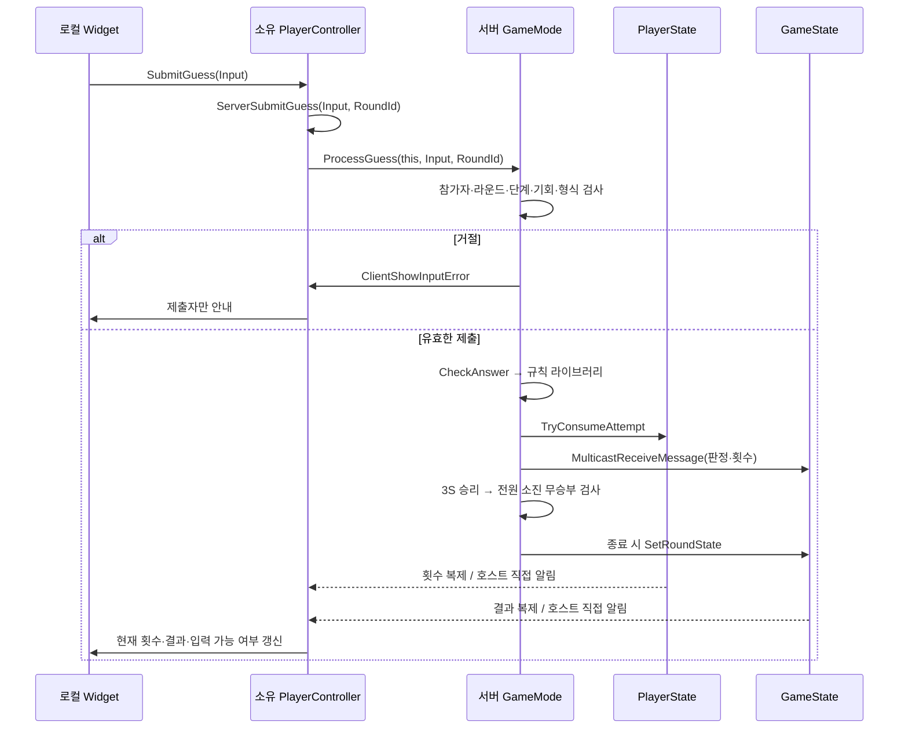

# CH4_1

UE 5.6 멀티플레이 숫자 야구 개인 과제. 서버 권한과 RPC/Replication 흐름을 이해하고 설명할 수 있도록 작은 단계로 구현한다.

현재 **M1 PIE 및 M2~M8 사용자 기능·통합 검증 완료(종료 크래시 제외)** 상태다. 서버 결과 확정 3초 후 횟수·정답·라운드를 초기화하고 입력을 재개하도록 연결했다. 턴 기능은 아직 없다.

| 클래스 | 현재 작성 내용 |
| --- | --- |
| NBGameMode | 2인 접속 정책, 서버 정답/입력/횟수/승패 처리, 이탈 시 대기 |
| NBPlayerController | 로컬 위젯 생성, 채팅/숫자 Server RPC, RoundId 전달, 개인 안내·상태 표시 |
| NBGameState | 일회성 메시지 Multicast, 라운드/결과 스냅샷 RepNotify |
| NBPlayerState | 서버 시도 횟수 소비/초기화, UsedAttempts/MaxAttempts 복제 및 변경 알림 |
| NBChatWidget | 채팅과 숫자 제출 분리, 최근 100건 표시, 라운드 단계와 횟수에 따른 입력 차단 |
| NBNumberBaseballLibrary | 상태를 변경하지 않는 입력 검증 및 S/B 계산 |
| FNBGuessResult | Strikes/Balls 및 OUT/nSnB 표시 문자열 |
| FNBRoundState | RoundId, Waiting/Playing/ShowingResult, 결과, 승자 이름/ID |
| NBResultWidget | 서버 라운드 스냅샷의 승자/무승부 표시, 대기/진행 시 숨김 |

GameMode가 생성할 클래스 타입을 지정하면 엔진의 기존 생성 흐름을 사용할 수 있다. PlayerController를 클라이언트에서 직접 생성하지 않는다. 서버 권한(HasAuthority)과 로컬 플레이어 여부(IsLocalController)는 구분하여 기록한다.

## 게임 규칙과 조작

Listen Server 호스트와 원격 클라이언트, 총 2명이 접속하면 자동 시작한다. 서버가 만든 중복 없는 1~9 세 자리 숫자를 각자 최대 3번 안에 먼저 맞히는 자유 입력 경쟁이다. 숫자와 위치가 같으면 Strike, 숫자만 같으면 Ball, 일치하는 숫자가 없으면 OUT이다.

일반 채팅창과 숫자 제출창은 분리되어 있다. 각 창에서 Enter 또는 버튼으로 제출한다. 숫자창은 정확히 ASCII 1~9 세 자리만 허용하며 0·중복·문자·공백은 거절한다. 잘못된 숫자와 일반 채팅은 기회를 소비하지 않는다. 화면의 `[1/3]`은 사용 횟수다.

3S를 먼저 서버에서 처리한 플레이어가 승리한다. 마지막 기회에서도 승리가 무승부보다 우선한다. 한 명만 소진하면 상대는 계속하며, 두 명 모두 소진하고 정답자가 없으면 무승부다. 결과를 서버 기준 3초 동안 유지한 후 새 라운드를 시작한다. 결과 중에도 채팅은 가능하다. 이탈하면 대기하고 다시 두 명이 되면 새 라운드로 시작한다.

## 실행 방법

UE 5.6 및 Unreal C++ 개발 환경에서 CH4_1.uproject를 열고 CH4_1Editor 타깃을 빌드한다. 이 프로젝트의 빌드와 에디터 검증은 사용자가 담당한다.

기본 검증은 L_NumberBaseball 맵에서 Play 옵션의 Number of Players=2, Play Net Mode=Play As Listen Server, 별도 게임 창으로 실행한다. BP_NBGameMode의 PC가 BP_NBPlayerController인지, PC의 ChatWidgetClass/ResultWidgetClass가 각각 WBP_NBChat/WBP_NBResult인지 확인한다. 기존 에셋이 연결되어 있다면 새로 만들 필요 없다.

이탈/재접속 검증은 PIE 종료 동작과 분리하기 위해 독립 프로세스를 사용한다. 먼저 빌드/에셋을 저장하고 PIE를 종료한다. 아래는 이 작업 환경의 PowerShell 명령이며 설치/프로젝트 경로가 다르면 바꾼다. 패키징이나 별도 Server Target은 필요 없다.

호스트를 실행한다.

```powershell
& "C:\Program Files\Epic Games\UE_5.6\Engine\Binaries\Win64\UnrealEditor.exe" "C:\UnrealProject\CH4_1\CH4_1.uproject" "/Game/Maps/L_NumberBaseball?listen" -game -port=7777 -windowed -ResX=960 -ResY=540 -log
```

다른 PowerShell 창에서 클라이언트를 실행한다.

```powershell
& "C:\Program Files\Epic Games\UE_5.6\Engine\Binaries\Win64\UnrealEditor.exe" "C:\UnrealProject\CH4_1\CH4_1.uproject" "127.0.0.1:7777" -game -windowed -ResX=960 -ResY=540 -log
```

클라이언트만 종료한 뒤 같은 클라이언트 명령을 다시 실행하면 재접속이다. 호스트를 재실행하면 새 서버이므로 기존 라운드의 재접속 검증이 아니다. localhost 명령은 같은 컴퓨터용이며 인터넷 접속/세션 검색 기능은 구현하지 않았다.

## 숫자 제출의 처리 흐름



PC의 Server RPC만 네트워크 요청이다. 서버 PC에서 GameMode로 전달하는 호출은 서버 내부 일반 함수 호출이다. 발신자 이름/ID를 클라이언트에서 받지 않고 요청을 받은 PC로 식별한다. 소유권은 RPC를 요청할 통로이며 승패를 수정할 권한이 아니다.

| 데이터/이벤트 | 원본 및 수정 주체 | 전달 방식 |
| --- | --- | --- |
| SecretAnswer | 서버 GameMode만 | 복제하지 않음 |
| UsedAttempts / MaxAttempts | 서버 PlayerState | 모든 클라이언트 RepNotify |
| RoundId / Phase / Result / WinnerName / WinnerPlayerId | 서버 GM 결정, GS 보관 | FNBRoundState RepNotify |
| 채팅·개별 판정 메시지 | 서버 GM 작성 | GS NetMulticast, Reliable |
| 잘못된 입력 안내 | 서버 GM 판단 | 소유 PC Client RPC, Reliable |
| 채팅·숫자 제출 | 로컬 사용자 입력 | 소유 PC Server RPC, Reliable |
| 재시작 타이머 | 서버 GM만 | 복제하지 않음 |

RPC는 현재 연결된 플레이어에게 일회성 메시지를 전달하고, Replication은 현재 상태를 전달한다. 그래서 결과 공지는 채팅 이력을 분석하지 않고 GameState를 읽는다. 다른 Actor의 메시지/복제 도착 순서를 가정하지 않도록 판정 메시지에 해당 시도의 RoundId와 사용 횟수를 함께 넣는다.

C++ 서버 변경은 OnRep를 자동 호출하지 않으므로 호스트에 직접 같은 갱신 경로를 호출한다. 원격 클라이언트는 OnRep로 갱신한다. 위젯 생성 직후에도 현재 상태를 읽어서 먼저 도착한 상태 알림을 놓치지 않는다. 숫자창은 Playing과 남은 기회를 모두 만족해야 열리며 서버도 독립적으로 재검사한다.

## 라운드 시작과 재시작

PreLogin/Login은 정원을 검사하고 PostLogin은 서버 이름을 등록한다. TryStartRound는 2인/Waiting/BeginPlay 완료를 확인한다. StartRound는 횟수 초기화 → 정답 생성 → RoundId 증가 및 Playing 공개 순서로 실행한다.

FinishRound는 ShowingResult를 공개하고 3초 단발 타이머를 예약한다. ResetGame은 예약 당시 RoundId와 현재 ShowingResult를 확인한 뒤 StartRound를 재사용한다. 클라이언트는 새 RoundId에서 숫자창을 비우고 복제 상태에 따라 공지를 숨기고 입력을 재개한다. 새 정답은 우연히 이전과 같을 수 있다.

Logout은 타이머를 취소하고 Waiting으로 돌아간다. EndPlay에서도 타이머를 해제한다. 호스트 종료는 서버 종료이며 호스트 이전은 지원하지 않는다. 3초는 서버 게임 시간 기준이고, 클라이언트마다 정확히 3초 보이는 것을 보장하는 수신 확인 절차는 없다.

## 구현 과정과 검증 범위

M1 클래스 연결 → M2 채팅 RPC → M3 순수 규칙 라이브러리 → M4 개인별 횟수 복제 → M5 라운드/승패 → M6 결과 UI → M7 서버 자동 재시작 순서로 구현했다. Blueprint는 화면 배치와 클래스 기본값을 담당하고 핵심 규칙은 C++에 둔다. 현재 M8에서 최종 구조와 통합 검증 절차를 정리했다.

규칙 계산은 `NB.Rules.InputValidation`, `NB.Rules.GuessEvaluation`, `NB.Rules.AllValidNumbers` Automation Test로 작성했다. 고정 정답 386의 S/B/OUT, 잘못된 형식, 504개 유효 숫자의 자기 비교를 확인한다. M3에서 사용자 검증 완료 보고를 받았으며 모든 가능한 정답/입력 조합을 전수 검사한 것은 아니다.

- M2~M7 단계별 기능은 사용자 검증 완료 보고를 받았다. M7은 종료 크래시를 제외했다.
- M8 코드 대조/문서 정리와 최종 통합 시나리오는 완료했다(2026-10-08 사용자 실행 완료 보고). 문서만 변경하여 이번에 빌드/계산 테스트를 재실행하지 않았다.
- 이전 RoundId 강제 제출, 지연된 종료 후 RPC, 생성 순서별 UI 복원, Dedicated Server, 패키징·외부 네트워크는 별도 실행 증거가 없다.
- 턴제와 턴 제한 시간은 M9/M10 예정이며 현재 구현 범위가 아니다. 채팅 속도 제한, 과거 채팅 재접속 복원도 없다. 로컬 이력은 최근 100건이다.
- 개발용 정답 로그는 서버에서만 출력하고 Shipping에서는 제외한다. 게임 UI로 정답을 보내지 않는다.

최종 통합 확인과 설명 연습은 [M8 체크리스트](Docs/M8_INTEGRATION_CHECKLIST.md)를 따른다. 단계별 문서의 '아직 승패 없음/결과 유지' 같은 설명은 해당 단계 기록이며 현재 동작은 이 README와 M7 이후 문서를 우선한다.

- [M1 빌드·에디터·PIE 확인 절차](Docs/M1_EDITOR_CHECKLIST.md)
- [M2 채팅 위젯·PIE 확인 절차](Docs/M2_EDITOR_CHECKLIST.md)
- [M3 숫자 제출 위젯·규칙 테스트·PIE 확인](Docs/M3_EDITOR_CHECKLIST.md)
- [M4 시도 횟수 표시·복제·입력 차단 검증](Docs/M4_EDITOR_CHECKLIST.md)
- [M5 라운드 시작·승패·접속 정책 검증](Docs/M5_EDITOR_CHECKLIST.md)
- [M6 결과 공지 위젯 생성·연결·검증](Docs/M6_EDITOR_CHECKLIST.md)
- [M7 자동 재시작·반복 라운드·이탈 검증](Docs/M7_EDITOR_CHECKLIST.md)
- [로그·조기 반환 유틸리티 사용법](Docs/NB_UTILITY.md)
- [진행 상태](TASKS.md)
- [클래스와 네트워크 설계](ARCHITECTURE.md)
- [작업 규칙](AGENTS.md)

별도 미해결 이슈: 클라이언트 종료 중 엔진 스레드풀 assertion이 한 차례 발생했다. 현재 동일 조건에서도 미재현이며 원인은 확정되지 않았다. [조사 기록](Docs/M7_SHUTDOWN_CRASH.md).
